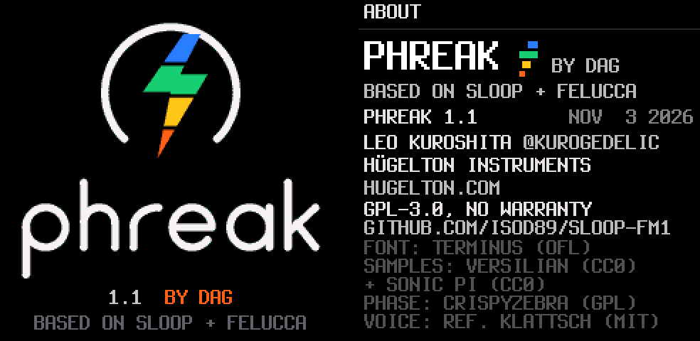
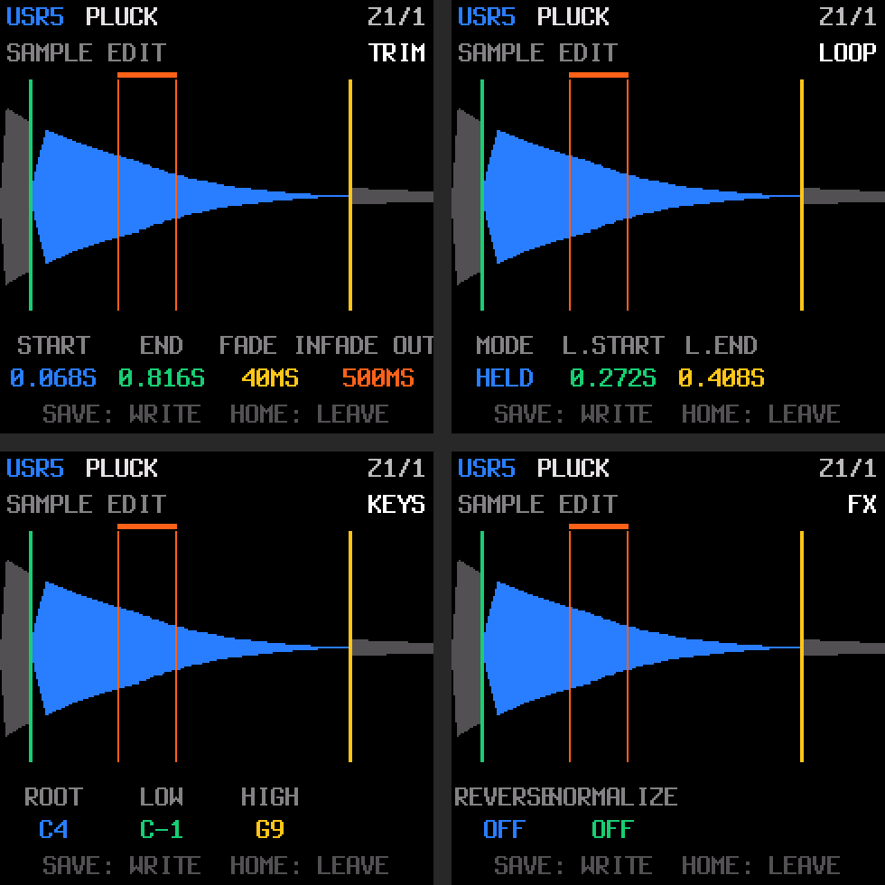
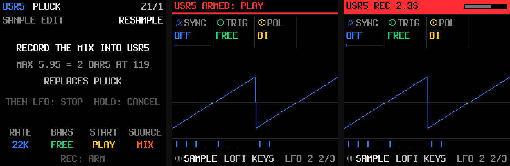

<p align="center"></p>

<p align="center"><b>A six-track groovebox firmware for the M-VAVE FM-1, built for your own samples.</b><br>
By <a href="https://dagnazty.dev/">dag</a>.<br>
Free and open source (GPL-3.0), based on <a href="https://github.com/isod89/sloop-fm1">SLOOP</a> 2.8.4 by isod89 and <a href="https://github.com/hugelton/Felucca">Felucca</a> by Leo Kuroshita / Hügelton Instruments.</p>

<p align="center">
<a href="#install">Install</a> ·
<a href="#quick-start">Quick start</a> ·
<a href="EXTRAS.md">What PHREAK adds, in detail</a> ·
<a href="GUIDE.md">Complete guide (SLOOP)</a> ·
<a href="BUILDING.md">Building</a>
</p>

---

PHREAK turns the FM-1 into a **six-track groovebox**: three synth tracks and **three drum tracks** (D1, D2, D3) playing together. Drums come from a USB stick: plug in a stick of WAVs, pick a folder on the FM-1's screen and it becomes a kit. Then shape those samples like a synth, with an **envelope, a resonant filter, an LFO, tune, bit crush, drive and loop**. Songs have **eight sections, A to H**. Everything else in SLOOP is still there: twelve synth engines and 153 sounds, 37 drum kits, parameter locks, punch-in effects, song mode, the web editor, MIDI and USB audio.

> **Status:** PHREAK **1.9**, a personal fork, tested on one FM-1. Install it at your own risk. Your projects, presets, samples and settings are kept when you update, and you can go back to SLOOP or the official firmware at any time (see [Going back](#going-back)).

<p align="center"></p>

<p align="center"><sub>The boot screen and the ABOUT page, as the firmware draws them (rendered by the host tests: a release build shows its number where these say DEV).</sub></p>

## Contents

1. [What PHREAK adds](#what-phreak-adds)
2. [Install](#install)
3. [Quick start](#quick-start)
4. [Samples from a USB stick](#samples-from-a-usb-stick)
5. [Three drum tracks](#three-drum-tracks)
6. [Shaping your samples](#shaping-your-samples)
7. [Eight song sections](#eight-song-sections)
8. [The controls](#the-controls)
9. [Everything from SLOOP](#everything-from-sloop)
10. [Six sample slots](#six-sample-slots)
11. [Sample editor](#sample-editor)
12. [Resampling](#resampling)
13. [Your samples in PRESETS](#your-samples-in-presets)
14. [Live sampling in the web editor](#live-sampling-in-the-web-editor)
15. [Limits and differences from SLOOP](#limits-and-differences-from-sloop)
16. [Versions](#versions)
17. [Building and tests](#building-and-tests)
18. [Credits](#credits)
19. [Licence](#licence)

## What PHREAK adds

| | |
| --- | --- |
| **LOAD FROM USB** | Hold **OCT+** while switching on. Browse a FAT32 stick, starting in `SAMPLES/`, through as many folders as you like, and load a folder of WAVs, or (1.2) one WAV alone, into one of six sample slots, USR1 to USR6. Any WAV works (8 to 32-bit, mono or stereo, any rate). [More](#samples-from-a-usb-stick) |
| **Three drum tracks** | **D1, D2, D3** play together, each with its own kit, pattern, length, DIV, swing, mute, pan and level. ALGORITHM turns through 1, 2, 3, D1, D2, D3. D2 starts on your USR1 kit, D3 on USR2. [More](#three-drum-tracks) |
| **USR kit sound** (1.1) | On a drum track playing a USR kit, the **ENV**, **LFO** and **EDIT** pages open: ADSR with a gate, a resonant LP / BP / HP filter, LFO to pitch, filter and level, TUNE, BITS, DRIVE and LOOP. Each drum track has its own settings. [More](#shaping-your-samples) |
| **Sections A–H** | Eight song sections instead of four, on the FM-1 and in the web editor. [More](#eight-song-sections) |
| **More trap** | Four more 808 basses (808 LONG, 808 PUNCH, 808 GRIT, 808 GLIDE) and three drum kits: **RAGE**, **PLUGG** and **MEMPHIS**. |
| **Sample editor** (1.5) | Hold **LFO**: trim, fade, loop, root note, key range, reverse and normalize a USR slot on the FM-1, over its waveform, and (1.6) hear your edits with **PLAY** before you save. [More](#sample-editor) |
| **Resampling** (1.8) | Record what the FM-1 is playing (punch-in FX and delay included) into a USR slot, then trim and loop it in the sample editor and play it from the keys or as a kit. [More](#resampling) |
| **USR sounds** (1.9) | USR1–USR6 are sounds in **PRESETS** like any other, listed with the sample's name: no more picking a SAMPLE sound and changing its SET. [More](#your-samples-in-presets) |
| **Live sampling** (1.9) | The web editor's Samples page records from a mic, an audio interface or the FM-1 itself (resampling over USB), trims it and sends it to a slot. [More](#live-sampling-in-the-web-editor) |
| **Six sample slots** (1.4) | USR5 and USR6 join USR1–USR4, in the flash the built-in VIBES, HORNS, STRGS, FLUTE, SCRCH and PERC sets took. PIANO and BASS stay. [More](#six-sample-slots) |
| **Its own look** | A new boot screen and ABOUT page: a lightning bolt in the four track colours, through the knob dial. |

The full technical description is in [EXTRAS.md](EXTRAS.md).

## Install

PHREAK is installed over USB from a computer, as SLOOP is. Your projects, user presets, samples and settings are kept.

**From the command line** (Python 3, with `pip3 install mido python-rtmidi`). Connect the FM-1 with a USB **data** cable, directly (no hub), close every other app that uses MIDI, then run:

```bash
python3 tools/fm1_install.py build/phreak-1.9.fwsc
```

It checks the package, puts the FM-1 in update mode, writes it and restarts it. `python3 tools/fm1_install.py --info` shows what the connected FM-1 runs; PHREAK X.Y reports itself as `FM-1_9XY` (1.9 is `FM-1_919`).

**From the browser.** The installer and the web editor in this repository can be served from your own computer, with your build inside (Web MIDI needs `localhost`):

```bash
python3 web/make_site.py build/phreak-1.9.fwsc 1.9 build/site
```

```bash
python3 -m http.server 8766 --bind 127.0.0.1 --directory build/site
```

Then open `http://localhost:8766/webapp/installer/` in **Chrome or Edge** and press **INSTALL**. The editor is at `http://localhost:8766/webapp/editor/`. Use this local editor, not SLOOP's online one: only this one knows sections E–H.

After an install, unplug and plug the FM-1 back in once, so the computer finds its USB audio input again.

### Going back

- **To SLOOP 2.8.4:** install its `.fwsc` the same way. SLOOP ignores sections E–H, D2 and D3 and the USR kit sound, and it sees the sample slots as 80 KB where PHREAK uses 68 KB of each. It also writes its firmware over USR5 and USR6, so those two are erased. **Save a backup in the editor first.**
- **To the official firmware:** save a backup, then use M-VAVE's own updater **M-UPGRADE** with the official FM-1 firmware (V16), as described in SLOOP's [GUIDE.md](GUIDE.md).

### Rescue

- **The FM-1 no longer starts PHREAK:** hold **OCT−** alone while switching it on (the screen says *SLOOP USB RESCUE*), then install again.
- **An install was cut off:** the FM-1 stays in update mode. Run the install again and it finishes.
- If an FM-1 no longer starts at all, recovery needs [FM-1-transporter](https://github.com/kurogedelic/FM-1-transporter).

> Custom firmware is installed at your own risk. No warranty.

## Quick start

1. **Put samples on a stick.** Format a USB stick as FAT32 and make a folder `SAMPLES`, with a folder per kit inside (`SAMPLES/MY KIT/KICK.wav`, `SNARE.wav`, `HAT.wav`…).
2. **Load them.** Plug the stick into a powered USB-C OTG adapter (see [the hardware](#the-hardware)), hold **OCT+** and switch the FM-1 on. Turn **KNOB** to your kit's folder, press **OCT+** to open it, pick **LOAD … > USR1** and press **OCT+**. Switch off and on again.
3. **Play them.** Turn **ALGORITHM** to **D2**: the screen says *DRUM TRACK D2*, and D2 plays the USR1 kit. The white keys are your samples, in file-name order.
4. **Make a beat.** Press **REC** and play, or tap **SEQ** for the drum grid. Turn ALGORITHM back to **D1** and record a second drum part: D2 keeps playing.
5. **Shape it.** On D2, tap **EDIT** until **TONE** shows: turn **CUT** down and **RES** up. Tap **ENV**: lower **SUS** and **REL** to make the hits shorter.
6. **Keep it.** Hold **SAVE** and press keys 5–8 to store the loop into sections A–D (key 15 first for E–H). Hold SAVE and press keys 1–4 or 9–12 to play them.

## Samples from a USB stick

Hold **OCT+** while switching on: **LOAD FROM USB** opens. The FM-1's USB link to the computer is off on this screen; switch off to leave.

- **Browsing:** it starts in `SAMPLES/`, or at the top of the stick if there is no such folder, and goes into folders at any depth. **KNOB** picks a line, **OCT+** opens a folder or loads, **OCT−** goes back up.
- **One file alone** (1.2): a folder also lists its WAV files (indented, after its folders). Press **OCT+** on one, then pick **LOAD THIS > USR1** to **USR6**: that file fills the slot and plays across the whole keyboard, from its note (`BASS C2.wav`) or C4. That's how you get a sample onto a synth or bass track: on track 1, 2 or 3, pick a SAMPLE sound with **PRESETS** (UP BASS, GRAND PNO…), then tap **EDIT** for its **SET** page and turn **KNOB 1 (SET)** to that slot, USR1–USR6. ENV, LFO, filter (CUT), TUNE and the rest then shape it as any synth sound. OCT− goes back to the folder.
- **Hear a file first** (1.3): with a file highlighted (or on its slot list), press **PLAY**. It plays through the FM-1's speaker or headphones, read straight from the stick, up to 30 s. (1.7) The **MASTER** knob sets its volume while it plays, as it does in normal play. Any button or other knob stops it.
- **Loading a folder:** a folder with WAV files in it lists **LOAD n WAVS > USR1** to **USR6** first. Up to 16 files go into the slot, mixed to mono and converted for the FM-1 (22,050 Hz ADPCM). A slot holds about **6.3 s**; when the files are longer, the longest are shortened, with a short fade, until everything fits.
- **Where the sounds land:**
  - **One file:** it plays across the whole keyboard (its root note from its name, else C4).
  - **Every name has a note** (`PAD C3.wav`, `PAD G3.wav`): the files split the keyboard between their notes, for a melodic instrument on a synth track.
  - **Otherwise:** the files go to the drum lanes in name order (KICK, KICK 2, SNARE, CLAP, HAT…), so the folder plays as a kit on a drum track.
- **WAV files:** 8, 16, 24 or 32-bit PCM, mono or stereo, any sample rate. Long file names are fine.

### The hardware

The FM-1 cannot power a USB stick, and a stick (or a hub) only shows up when it gets 5 V. Use a **USB-C OTG adapter with a charging port** (USB-C plug, USB-A socket, USB-C power in) with a phone charger plugged in: the charger powers the stick and charges the FM-1. A plain OTG adapter, or a hub that only powers its own ports, shows *PLUG IN A USB STICK*. Sticks over 32 GB usually come formatted as exFAT: reformat them as FAT32.

The loaded samples live in the FM-1's flash, in slots USR1–USR6: every synth track (SAMPLE engine, SET USR1–6) and every drum track (KIT USR1–4, USR3+4, USR5, USR6) can play them, and they stay after power-off until you load something else into the slot.

## Three drum tracks

**ALGORITHM** picks the track you see and play: **1, 2, 3** (synths), then **D1, D2, D3** (drums). The screen says *DRUM TRACK D2*; the TRACKS strip and the DRUMS screen say *d2* or *d3*.

- **The one you pick is the drum track** for everything: the DRUMS screen, the keys, REC, the step grid, the kit (PRESETS), LENGTH, DIV, swing, MUTE, PAN and LEVEL. D1's level is GLO → DRUMS → LVL, as before; D2 and D3 have their own.
- **All three play together**, wherever you are, and follow song mode.
- **At power-on** (and after NEW), D2 is on the **USR1** kit and D3 on **USR2**, both empty.
- **They are kept** with the working project and with every section A–H.
- They share the drums' **6 voices** (when more hits sound at once, the oldest gives way, the kick last), the INSERT, the FX filter and the sends.

## Shaping your samples

When the drum track you're on plays a **USR kit** (USR1–USR6 or USR3+4), these pages open on it. Factory kits still say *DRUM TRACK* there.

| Button | Page | KNOB 1 | KNOB 2 | KNOB 3 | KNOB 4 |
| --- | --- | --- | --- | --- | --- |
| **ENV** | ENV | ATK | DEC | SUS | REL |
| | ENV DEST | FLT: the envelope opens the filter | PIT: a pitch drop at the start | — | — |
| **LFO** | LFO | RATE | WAVE | PHASE | FADE |
| | LFO 2 | SYNC to the tempo | TRIG: NOTE / FREE | POL: BI / UNI | — |
| | LFO DEST | PIT: vibrato | FLT: wobble | — | AMP: tremolo |
| **EDIT** | SAMPLE | KIT | TUNE ±24 semitones | BITS | LOOP |
| | TONE | CUT | RES | DRV | — |
| | FILTER | TYPE: LP / BP / HP | CUT | RES | — |

- **Each hit holds for the step's GATE** (SEQ → PATTERN → GATE, a share of a step at the track's DIV), then plays its release. Played from the keys, a hit holds the same way. For long sounds, turn GATE up and DIV longer.
- **LOOP** plays the sample again from its start for as long as the hit holds: a short sample becomes a pad or a drone. Shape its end with REL.
- **The filter** is ANALOG's resonant one; ENV DEST → FLT and LFO DEST → FLT move it.
- **D1, D2 and D3 each have their own settings**, kept with the project and with each section A–H.
- **At the defaults** (no attack, SUS and REL full, CUT open, nothing else) a hit plays exactly as it did before 1.1, and costs no extra processing. Projects from before open that way.

## Eight song sections

| Hold SAVE and press | Does |
| --- | --- |
| keys **1–4** | play sections **A–D** on the next bar |
| keys **9–12** | play sections **E–H** |
| keys **5–8** | store the loop into **A–D**, or into **E–H** after key **15** switches them over (the tiles say which) |
| several keys | a quick chain, mixing A–H freely |

SAVE → SECTION lists all eight in two columns, the SONG screen picks any of them, and the local web editor's sections, Song, LIVE, backup and song-file pages carry E–H.

## The controls

| Control | What it does |
| --- | --- |
| **ALGORITHM** | the track: 1 · 2 · 3 (synths) · D1 · D2 · D3 (drums) |
| **PRESETS** | the selected track's sound, or the drum kit |
| **KNOB 1–4** | the four values at the bottom of the screen, each in its colour |
| **OCT− / OCT+** | octave (both: back to 0) · on a drum track, held: ghost / hard hits |
| **FX · SEL · ENV · LFO · EDIT · GLO** | tap: their pages · hold FX, SEL, EDIT, GLO: a layer · hold LFO: the [sample editor](#sample-editor) |
| **HOME** | the TRACKS screen · hold: the menu. **ABOUT** (the PHREAK version): hold HOME, turn **SELECT** to the SYSTEM section, **PRESETS** down to ABOUT, **OCT+** opens it, **OCT−** closes |
| **SAVE** | on TRACKS: the SONG screen · hold: the song layer (sections A–H, above) |
| **ARP · SEQ** | tap: their pages · hold: note repeat · steps |
| **PLAY · REC** | start / stop · record, overdub, hold to clear the track |
| **EDIT + OCT− / OCT+** | undo / redo |
| **OCT+ held at power-on** | LOAD FROM USB |
| **OCT− held at power-on** | USB rescue |

Every page, layer and combination is described in SLOOP's [GUIDE.md](GUIDE.md); this README lists what PHREAK changes.

## Everything from SLOOP

PHREAK keeps all of SLOOP 2.8.4. In short:

- **Twelve synth engines and 153 sounds:** analog, 4-op FM, 6-op FM with DX7 patches, phase distortion, three-oscillator, tonewheel organ, formant voice, granular, lo-fi chip, sampler, physical models and noise.
- **Drums:** 16 sounds on the white keys, ghost and hard hits, ratchets, 37 kits plus PHREAK's three, your USR and SYN kits, per-sound TUNE and DECAY.
- **The sequencer:** 64 steps per track with its own length and division, chords, ties and slides, parameter locks, micro timing, fill conditions, MPC swing, live recording with overdub, a free take or a set tempo.
- **Performance:** 27 punch-in effects, note repeat, live erase, chords and scales on the keys, mute, solo, fills, tap tempo.
- **Effects:** an INSERT and a filter on every track, chorus, tempo delay and reverb, the master DUST, DUCK, DJ filter and limiter, the TEXTURE bed.
- **MIDI and audio:** USB MIDI in and out, TRS MIDI in, MIDI clock in and out, CCs and MIDI LEARN, a USB audio input for recording on a computer or phone.
- **The web editor:** sounds, sequencer with piano roll, MIDI files, CHOP, drum kits and drum synth, DX7 cartridges, LIVE page, backups.

## Six sample slots

PHREAK 1.4 has six user sample slots, USR1 to USR6, each about 6.3 s. To make room, the firmware no longer carries most of SLOOP's built-in samples. Only **PIANO** and **BASS** are left. LOAD FROM USB and the web editor's Samples page list all six slots.

- **On a synth track:** SAMPLE's **SET** (and GRAIN's **SRC**) goes PIANO, BASS, USR1 … USR6.
- **On a drum track:** the kits USR5 and USR6 come after SYN4. The other kit numbers don't change.
- **What went:** the sample sets VIBES, HORNS, STRGS, FLUTE, SCRCH and PERC, their presets (VIBES, HORN STAB, STRING STB, LOFI FLUTE, SCRATCH, GM KIT) and GRAIN's VIBE HAZE, FLUTE DUST, STR CLOUD and HORN CLOUD. PERC was also the sound of the five sampled drum kits, so **ACOUSTIC, DEEP, TIGHT, BRIGHT and DUST** went with it. The kits now start at 808. GRAIN's DRONE now uses BASS. A new project's third part is DUSTY PNO (it was LOFI FLUTE).
- **Old projects** still open. A part set to one of the removed sets plays PIANO, and a drum track on one of the removed kits plays the 808.
- **Where USR5 and USR6 live:** in the flash that used to hold the end of the firmware (0x71000–0x92FFF). The firmware itself is about 180 KB smaller now and ends below that point, and PHREAK's updater stops there, so later PHREAK updates keep both slots. The first install of 1.4 finds that area full of the old firmware's bytes; the slots show as empty until you load something into them. Installing SLOOP or an older PHREAK writes over them.

## Sample editor

Hold **LFO** for a moment to edit a sample slot on the FM-1 itself. It opens on the slot the selected track plays (a SAMPLE or GRAIN sound set to USR1–USR6, or a drum track on a USR kit); otherwise on the slot you edited last.



| Control | What it does |
| --- | --- |
| **PRESETS** | the slot, USR1–USR6 |
| **ALGORITHM** | the zone: one sample of the slot (a key split, or a drum lane in a kit) |
| **LFO** (tap) · **OCT− / OCT+** | the page: TRIM, LOOP, KEYS, FX, RESAMPLE (1.8, see [Resampling](#resampling)) |
| **TRIM** | KNOB 1 **START**, 2 **END**, 3 **F.IN** (fade in, ms), 4 **F.OUT** (fade out, ms) |
| **LOOP** | KNOB 1 **MODE**: OFF, LOOP, or HELD (loops while you hold the key, then plays to the end); 2 **L.START**, 3 **L.END** |
| **KEYS** | KNOB 1 **ROOT** (the note it plays at its own pitch), 2 **LOW**, 3 **HIGH** (the keys it covers) |
| **FX** | KNOB 1 **REVERSE**, 2 **NORMALIZE** (loudest point to full level) |
| **PLAY** (1.6) | hear the zone as you've edited it, before saving: trim, fades, reverse, normalize and loop included. A line shows where it's playing. **PLAY** again stops it. A HELD loop keeps looping while you hold PLAY |
| **SAVE** | writes the slot (stop the song first) |
| **HOME** or **LFO** held | leaves; with unsaved edits, press it a second time to throw them away |

The screen shows the zone's waveform, with what you trimmed off in grey, START and END as lines, and the loop marked above. Nothing is changed until **SAVE**. **PLAY** previews your edits at the sample's own pitch. The keys still play the track as usual, so they play the saved version. While a preview plays, the tempo delay is silent: the preview borrows its memory.

When you save, edits that only change the loop or keys leave the audio itself untouched. A trim, fade, reverse or normalize writes that zone's audio again, a little lower in quality each time, as with any re-encode. A trimmed slot gets the cut part back as free room. Saving takes about a second, and the audio pauses while it writes.

## Resampling

New in 1.8: record the FM-1's own sound into a sample slot. Bounce a chord stack, an arp, a drum fill or a punch-in FX run into one sample, then pitch it, chop it and play over it.



1. Hold **LFO** to open the sample editor, turn **PRESETS** to the slot to record into, and go to the **RESAMPLE** page (**OCT−** from TRIM).
2. Set the four knobs:

   | Knob | Settings |
   | --- | --- |
   | **RATE** | **22k** (up to 5.9 s) or **44k** (up to 3 s, for short hits) |
   | **BARS** | **FREE** (until you stop it or it's full), or **1, 2, 4, 8** bars at the current tempo. Lengths that don't fit at this tempo are skipped |
   | **START** | **PLAY**: when the song plays, on the next bar (from stopped, PLAY starts it on bar 1). **NOW**: at once. **NOTE**: on the first sound |
   | **SOURCE** | **MIX**: everything you hear. **DRY**: before the chorus, delay, reverb, DUST, punch-in FX and DJ filter |

   The screen shows the longest take at this rate and tempo.
3. Press **REC**. If the slot already holds a sample, or you have unsaved edits, press **REC** again to replace it.
4. The editor closes and a red line at the top of the screen shows the take: armed, then recording with its seconds and a level meter (it turns white once the take hits full level). Play as usual: keys, sequencer, knobs, punch-in FX.
5. The take stops after its bars, when it's full, when you tap **LFO**, or (START PLAY) when you stop the song.
6. Once the song is stopped, the take is written to the slot (about a second, the audio pauses) and the editor opens on it, ready to trim, loop or normalize.

**Hold LFO** while a take is armed or recording to drop it; the slot keeps what it had. Tapping LFO while it's armed drops it too.

The take is one sample over the whole keyboard at C4, named RESAMPLE. Play it from **PRESETS** (1.9: the slot's own sound, USR1–USR6, shows it as RESAMPLE), or as the slot's USR kit on a drum track (every lane plays it).

- **What it records:** the mix before the **MASTER** knob, as USB AUDIO = FULL does, so MASTER only changes what you hear. Left and right are mixed to mono. The metronome is left out.
- **The delay keeps working** while a take is armed or recording, on half its memory: its longest time is 0.74 s instead of 1.49 s (a 1/4 note down to 81 BPM). Its echoes start again from silence when you arm and when the take is written.
- **Not kept while the FM-1 is off:** a take that is finished but not yet written (the song still playing) is lost if you switch off.

## Your samples in PRESETS

New in 1.9: each sample slot is a sound of its own. Turn **PRESETS** and you'll find **USR1** to **USR6** at the end of the list, one turn left of the first sound, each shown with the name of the sample in it (or EMPTY). Pick one and the track plays that slot across the keyboard, like any other sound; ENV, FILTER and the rest work as usual.

You can still reach a slot the old way (a SAMPLE sound, then EDIT → SET), and drum tracks still play a slot as a USR kit. Program Change numbers for the other sounds don't change: the USR sounds come after them.

## Live sampling in the web editor

New in 1.9: the web editor's **Samples** page has a third way to make a sound, **Record live**, next to *From files* and *Chop a recording*.

1. Connect the FM-1, open **Samples**, pick the slot (step 1) and choose **Record live** (step 2).
2. Pick the **Source** and allow the microphone. Any input your computer has works: its mic, an audio interface. The **FM-1** is listed too (it's a USB audio device): pick it to record what it plays, which is resampling at any length the slot holds. Set the FM-1's menu **USB AUDIO** to **FULL** to record it before the MASTER knob.
3. Press **Record**, or tick **Start on sound** to start on the first sound (from 10 ms before it). The meter shows the level; the take stops by itself when the slot is full.
4. Trim it with **Start** and **End**, **Hear** it, and **Add to the list**. It's mono at 22050 Hz, normalized unless you untick it.
5. Send it in step 3, as with files. Record several takes into the same slot to split the keyboard or build a kit.

Nothing is heard through the computer while it records, so there's no feedback. Recording needs Chrome or Edge on HTTPS or localhost, as the editor's MIDI does.

### Editing a sample before you send it

Every file in a slot's list (from files or recorded) has an editor: click its name (✎). It shows the waveform and:

| Control | What it does |
| --- | --- |
| **Start**, **End** | trim it |
| **Fade in**, **Fade out** | 0–2000 ms |
| **Pitch** | −12 to +12 semitones, like a tape: up is shorter, down is longer |
| **Rate** | what the slot stores: 22, 16, 11 or 8 kHz (see below) |
| **Reverse**, **Normalize** | flip it; set its loudest point to full level |
| **Hear** | play it as the FM-1 will, rate included |
| **Reset** | back to the file as loaded |

Your file itself never changes: the edits are made again from it each time, and sent with step 3. Gain and the loop (ONE SHOT, LOOP, LOOP+TAIL with its points) stay on the row.

### Longer samples

A slot holds about 6.3 s at 22 kHz. A sample can be stored at a lower rate to fit more: **16 kHz** up to 8.7 s, **11 kHz** up to 12.6 s, **8 kHz** up to 17 s, a little darker at each step (lo-fi at 8 kHz). When what you add doesn't fit, the editor lowers the rate of the longest sample until it does and says so; **Fit to the slot** does the same after you change things, and each sample's **Rate** can be set by hand. The FM-1 plays every rate at the right pitch; nothing to change on it.

## Limits and differences from SLOOP

- **Sample slots are 68 KB** (about 6.3 s; 80 KB in SLOOP): the last 12 KB of each slot keep D2 and D3. A slot filled with more than 68 KB before PHREAK reads as empty: load it again.
- **D2 and D3:** only D1 has parameter locks; D2 and D3 send no MIDI while another drum track is shown.
- **The web editor** sees the drum track on screen; its backups keep D1, not D2 and D3. The version string it reads stays `SLOOP 2.8.4+`.
- **USR kit sound:** ENV SYNC and the SHAPE amounts do nothing on drums (their knobs show "—"); a hit holds for GATE, not for as long as you hold the key.
- **Kit numbers:** RAGE, PLUGG and MEMPHIS come after JAZZ, so the user kits (USR1–4, SYN1–4) are three numbers higher than in SLOOP.
- **Built-in samples** (1.4): only PIANO and BASS are left, with their presets GRAND PNO, UP BASS, DUSTY PNO, LOFI KEYS and DEEP BASS, and GRAIN's LOFI CLOUD, SHIMMER, DRONE and PNO FREEZE. The drum kits ACOUSTIC, DEEP, TIGHT, BRIGHT and DUST are gone with PERC. See [Six sample slots](#six-sample-slots).
- **After a crash:** sections E–H and every section's D2 and D3 are not in the RAM that survives a reset. What you store while playing is lost only if the FM-1 crashes in the seconds before it's written to flash.

## Versions

| Version | Identity | What changed |
| --- | --- | --- |
| **1.9** | FM-1_919 | USR1–USR6 as sounds in PRESETS; the web editor records live (mic, interface, or the FM-1 over USB) into a slot |
| **1.8** | FM-1_918 | resampling: record the FM-1's own mix into a USR slot (the sample editor's RESAMPLE page) |
| **1.7** | FM-1_917 | LOAD FROM USB: the MASTER knob sets the preview's volume |
| **1.6** | FM-1_916 | sample editor: PLAY previews the edits before you save |
| **1.5** | FM-1_915 | the sample editor: hold LFO to trim, fade, loop, retune, map, reverse and normalize a USR slot |
| **1.4** | FM-1_914 | sample slots USR5 and USR6, in place of the built-in sets VIBES, HORNS, STRGS, FLUTE, SCRCH and PERC (and the kits ACOUSTIC to DUST) |
| **1.3** | FM-1_913 | LOAD FROM USB: PLAY previews the highlighted WAV through the FM-1 before you load it |
| **1.2** | FM-1_912 | LOAD FROM USB lists a folder's WAV files: load one alone into a slot, across the keyboard, for a synth or bass track; *by dag* on the boot screen and ABOUT |
| **1.1** | FM-1_911 | ENV, LFO and EDIT pages for USR kits on the drum tracks: envelope with gate, resonant filter, LFO, tune, bits, drive, loop |
| **1.0** | FM-1_910 | the name PHREAK and its own boot screen and ABOUT page |
| **0.9** | FM-1_909 | drum tracks D2 and D3; the earlier payphone sounds, kits and screen removed; 68 KB sample slots |
| **0.8** | FM-1_908 | song sections A–H |
| **0.5–0.7** | | LOAD FROM USB: the stick, folders at any depth, long file names |
| **0.4** | | the USB host probe, finding the stick through a powered adapter |
| **0.1–0.3** | | first builds on SLOOP 2.8.4: a payphone theme and the trap sounds |

## Building and tests

You need the JieLi toolchain and the AC79 SDK, Python 3 with Pillow, and Docker on a Mac (see [BUILDING.md](BUILDING.md)). Then:

```bash
sh build.sh --release 1.9
```

That writes `build/phreak-1.9.fwsc`. The JieLi clang sometimes crashes under Docker on Apple silicon; run the build again and it goes through.

```bash
sh tests/run_tests.sh
```

This runs the host test suite with no hardware: audio renders against golden hashes, the sequencer, the UI pages, flash storage, the update loader, MIDI, the web pages, and PHREAK's own tests ([usbstick_test.c](tests/usbstick_test.c), [xdrums_test.c](tests/xdrums_test.c), [usrsound_test.c](tests/usrsound_test.c)). One check fails, *target cost of the render loops*: it fails on plain SLOOP 2.8.4 too, because its budget file is out of date upstream.

### Releases on GitHub

[.github/workflows/release.yml](.github/workflows/release.yml) builds a release on GitHub's Linux runners (no Docker): it downloads the JieLi toolchain and the three AC79 SDK files the package needs (checked against their SHA-256), builds `phreak-X.Y.fwsc`, checks it with the installer's own package check (identity `FM-1_9XY`, the loader, every CRC), runs the web tests, builds the site, and publishes both as a GitHub release, with that version's row from the table above as its notes.

```bash
git tag v1.9 && git push sloop v1.9
```

Or run it by hand from the repository's **Actions → Release → Run workflow** with a version: that makes a draft release unless *publish* is ticked.

The boot logo comes from [tools/gen_phreak_logo.py](tools/gen_phreak_logo.py) (`--assets DIR` writes the PNGs used here).

## Credits

- **PHREAK** by **[dag](https://dagnazty.dev/)**.
- **[SLOOP](https://github.com/isod89/sloop-fm1)** by **isod89**: everything PHREAK is built on, and everyone SLOOP credits (see [SLOOP.md](SLOOP.md) and [GUIDE.md](GUIDE.md)).
- **[Felucca](https://github.com/hugelton/Felucca)** by **Leo Kuroshita** (@kurogedelic) / **Hügelton Instruments**: the firmware SLOOP grew from.
- The USB host mode follows JieLi's AC79 SDK.
- Samples: Versilian Studios VSCO-2 CE and VCSL, Sonic Pi (CC0). Font: Terminus (SIL OFL 1.1). Icons: Fukiai (MIT). PHASE engine after CrispyZebra (GPL); VOICE after klattsch (MIT); FM6: msfa from Dexed (Apache-2.0). Details in [LICENSING.md](LICENSING.md).

## Licence

Code: GPL-3.0-only (see [LICENSE](LICENSE), and [LICENSING.md](LICENSING.md) for the assets). No warranty. M-VAVE and FM-1 are trademarks of their owners; PHREAK is not affiliated with M-VAVE or with the SLOOP and Felucca projects. Drum kit names describe styles, not products.
